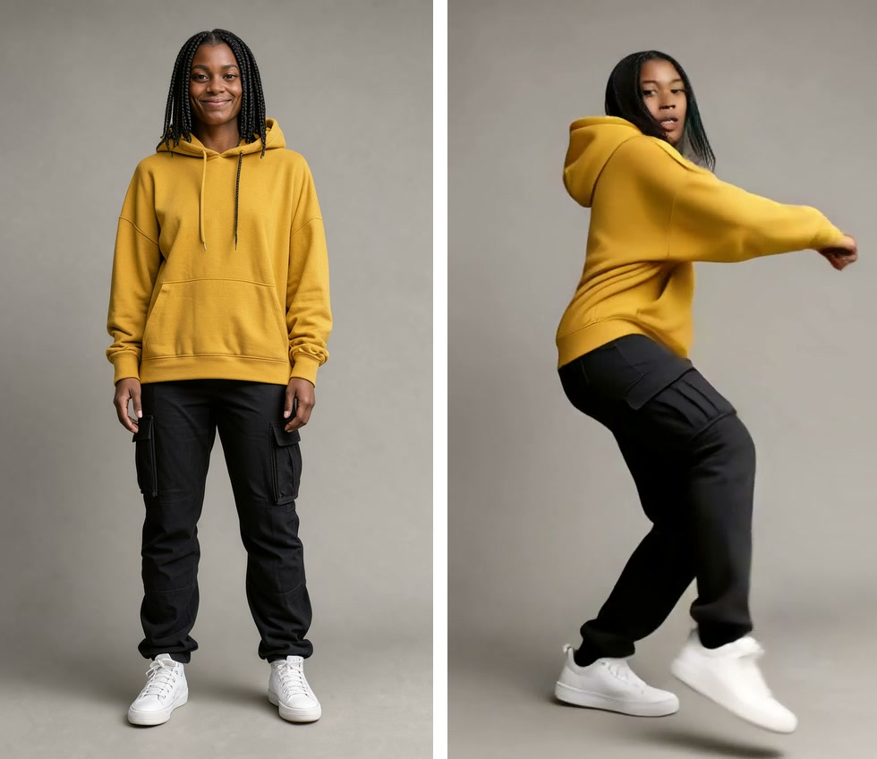

# Open Photon

[](https://github.com/WojciechJelen/open-photon/actions/workflows/ci.yml)

Turn a short motion clip and a character image into a video of that character doing
the same motion. Open Photon runs the open-weights Wan Animate 2 workflow on Comfy
Cloud or your own GPU, with side-by-side playback, two downloads per take (the result,
and a vertical 9:16 side-by-side of the source clip and the result with its audio,
stitched with FFmpeg when the take finishes, for TikTok, Reels and X), share pages and
reproducible recipes. Characters come from a workspace library: describe
one and render it with the open-weights FLUX 3 Image Klein (`/characters/new`), or
upload a photo with the person's consent, then find and animate it from
`/characters`.

**Try it:** [open-photon-staging.up.railway.app](https://open-photon-staging.up.railway.app/). The
home page, the samples and every share page open without a code. Judges: use the link in the
submission form; it signs you in and opens the character builder (`/characters/new`).

<p align="center">
  
  
</p>
<p align="center"><sub>Left: a take's side-by-side download, driving clip | result (cropped, as a GIF).
Right: a character FLUX 3 Image Klein rendered from a short description and three controls,
expanded by the prompt upsampler, beside a frame of
Wan Animate 2 animating her. Both from a pre-rendered sample take;
<a href="docs/readme/README.md">how they were cut</a>.</sub></p>

## Getting started

<a id="run"></a>

### Run the containerized app

With Docker installed, put one backend in `.env` ([Comfy Cloud or Runpod](#choose-a-rendering-backend)), then:

```sh
docker run -d --name open-photon --init --env-file .env -p 127.0.0.1:3030:3000 \
  -v open-photon-data:/app/data ghcr.io/wojciechjelen/open-photon:0.2.0
# Open http://localhost:3030 once, then print an access code:
docker exec open-photon node scripts/mint-code.mjs me 100
```

Volumes, Compose, filling the result wall and a run from source: [Setup](#setup).

## Numbers

One 5-second 480×848 Motion Transfer take, one caption, one 768×1344 character image:

| Workflow | Backend | Submit → done | Peak VRAM | Cost |
| --- | --- | --- | --- | --- |
| Motion Transfer | Comfy Cloud | 70.6–115.7 s (6 takes) | — | ≈ 8.2 ¢ (17.3 credits) |
| Motion Transfer | RTX 5090 32 GB | 158.7 s (Oct 21); 167.8 s (`0.1.0`) | 31,066; 31,426 MiB | pod time |
| Motion Transfer | A40 48 GB | 255.9 s (`0.2.0`); 149.1 s (`0.1.0`) | 38,935 MiB (`0.2.0`) | 255.9 s × $0.59/h ≈ $0.04 |
| FLUX 3 caption | Comfy Cloud | 5.0 s | — | ≈ 0.08 ¢ |
| FLUX 3 caption | A40 48 GB | 26.6 s | 6,601 MiB | pod time |
| FLUX 3 image | Comfy Cloud | 14.3 s | — | ≈ 0.8 ¢ |
| FLUX 3 image | A40 48 GB | 31.9 s | 10,653 MiB | pod time |

Sources: Cloud Motion Transfer [DEV-280](CHECKLIST.md#sample-matrix-and-result-wall-dev-280), its direct-submit execution [CHECKLIST 1.6](CHECKLIST.md#phase-1--the-workflow-as-data); RTX 5090 [CHECKLIST 8.3](CHECKLIST.md#phase-8-open-weights-proof) (Oct 21) and the [Oct 23 follow-up](CHECKLIST.md#deployment-evidence-after-the-docker-simplification); A40 `0.2.0` and its pod rate the [self-host proof](docs/selfhost-proof-2026-10-23/README.md); A40 `0.1.0` [CHECKLIST](CHECKLIST.md#deployment-evidence-after-the-docker-simplification); FLUX 3 on Cloud the [character workflows README](src/features/characterBuilder/workflows/README.md#measurements-comfy-cloud-2026-10-23).

Cloud Motion Transfer times are the six sample takes through the app, side-by-side stitch
included; a direct submit's ComfyUI execution took 64.9 s. Cloud cost is the account balance drop
over the six takes, per take; Cloud VRAM is not observable. A40 VRAM is the whole-device `nvidia-smi` peak while
the job ran. The RTX 5090 (Oct 21) and A40 `0.2.0` jobs were each the first of their models on
the pod, so model loading is included. The whole A40 run (boot, model download, three jobs,
restart) cost about $0.21 of pod time.

## Setup

Browsing samples is public; uploads and new generations require an access code.
Opened a link that already contains a code? You're in.
New renders use your Comfy Cloud credits or your self-hosted GPU.

### Choose a rendering backend

Save **one** of these configurations in `.env`:

**Comfy Cloud:** create a [Comfy Cloud](https://cloud.comfy.org) API key with workflow
access and credits.

```dotenv
COMFY_API_KEY=your-cloud-key
```

**Runpod:** deploy the [Open Photon template](https://console.runpod.io/deploy?template=iqcvzqgt1q)
on an NVIDIA GPU with a **CUDA 13-compatible driver**. **48 GB VRAM is recommended** (peaks per
workflow in [Numbers](#numbers)); 32 GB passed with little headroom.
Set `PROXY_TOKEN` to a long random secret, and `HF_TOKEN` to a Hugging Face token of an account
that accepted the FLUX Kommunity License on
[black-forest-labs/flux-3-image-klein-comfy](https://huggingface.co/black-forest-labs/flux-3-image-klein-comfy)
(character generation's weights are gated there; without it the first boot stops). The template
supplies the GPU image, port `8189` and an 80 GB persistent volume at `/workspace`. Wait for
`Serving the Comfy API v2` in the logs; the first boot downloads 43.4 GB (40.4 GiB) of models to
that volume: 25.6 GB for Motion Transfer and 17.7 GB for character generation (FLUX 3 Image Klein
distilled int8, its Qwen3-VL text encoder, its prompt upsampler and the FLUX 2 VAE), which leaves
about 36 GB for ComfyUI's inputs and outputs (on the A40 test, the download took 5 minutes and
the API served 9 minutes after the pod was created; a restart downloads nothing but re-checks
every file, about 4 minutes). A volume of your own needs at least 50 GB. The GPU
runs one job at a time, so it must fit the largest workflow, Motion Transfer. Then save:

```dotenv
COMFY_BASE_URL=https://POD_ID-8189.proxy.runpod.net
COMFY_PROXY_TOKEN=the-same-secret-as-PROXY_TOKEN
```

Leave `COMFY_API_KEY` unset for Runpod. Stop the pod when unused; terminate it to
remove its pod storage too. Separately created network volumes continue billing.
Each input file has 10 minutes to reach the backend (enough for a 128 MiB clip at about
1.8 Mbit/s); on a slower uplink, raise `COMFY_UPLOAD_TIMEOUT_MS` (milliseconds, up to an hour).

### Run locally from source

Install Node.js 24+, npm 11.6.2 and FFmpeg (including `ffprobe`), then:

```sh
git clone https://github.com/WojciechJelen/open-photon.git
cd open-photon
npm ci
cp .env.example .env
# Edit .env with the backend settings above.
npm run dev
```

Open [localhost:3030](http://localhost:3030). Once the app has initialized its
database, run this in another terminal from the repository directory:

```sh
node --env-file=.env scripts/mint-code.mjs me 100
```

Enter the printed access code in the app. `100` is its generation allowance. A link
`/access?code=<code>&next=/characters/new` signs in on opening and lands on that page.

### Container notes

The published app image runs either backend on Linux AMD64 and ARM64; it needs no repository
clone, Node installation or local build. The volume keeps results and access codes across
container replacement. From a
source checkout, you can instead use `docker compose up -d` and
`docker compose exec app node scripts/mint-code.mjs me 100` with the same `.env`.
Compose uses its own persistent volume.

To fill the home page's result wall, render every sample motion × sample character
once and mark the takes pre-rendered (public, and free to reopen without a code). With
the app running, mint a code for at least that many generations, then:

```sh
BASE_URL=http://127.0.0.1:3000 ACCESS_CODE=<code> node scripts/prerender-samples.mjs
```

Run it where the database is (in the container: `docker exec open-photon …`). Each
take is a Wan Animate 2 render billed to your backend; a second run submits nothing.

## Every model and tool

Models (pinned by file, revision and SHA-256 in the two locks below):

- **Wan Animate 2** (int8, `wan_animate_2_int8_convrot`): the video model; moves the character
  image the way the person in the driving clip moves.
- **lightx2v distillation LoRA** (`lightx2v_I2V_14B_480p_cfg_step_distill_rank64`): lets Wan
  Animate 2 render in 6 steps at CFG 1 instead of a full sampling schedule.
- **UMT5-XXL** (fp8): Wan's text encoder; encodes the take's prompt.
- **CLIP-ViT-H** (`clip_vision_h`): encodes the character image so the take keeps its identity.
- **Wan 2.1 VAE**: encodes the clip and character into Wan's latent space and decodes the result
  to frames.
- **FLUX 3 Image Klein** (distilled, int8): the image model; renders a caption into the character
  image, 16 steps.
- **Qwen3-VL-4B** (int8): FLUX 3's text encoder; turns the caption into the conditioning the
  image model reads.
- **Qwen3.5-9B FLUX 3 prompt upsampler** (w4a8): expands a short description into the full
  caption the user reviews and may edit.
- **FLUX 2 VAE**: decodes FLUX 3's latents to the PNG.

Tools:

- **ComfyUI 0.42** + **comfy-api-proxy** (self-host): run the workflow graphs on your GPU and
  serve them as the Comfy API v2 behind a bearer token.
- **Comfy Cloud** + **`@comfyorg/sdk`**: run the same graphs on Comfy's GPUs; the SDK uploads
  inputs, submits, follows progress and downloads outputs for both backends.
- **FFmpeg**: probes and trims uploaded clips, cuts posters, and stitches the 9:16 side-by-side
  download.
- **Node 24** + **`node:sqlite`**: the server, and the database of generations, recipes, assets and
  access codes.
- **TanStack Start**: the React app, its routes, server functions and server-side rendering.
- **Runpod**: the GPU pod template that runs the self-host image.
- **Railway**: hosts the live app.

## Open weights

The Open Weights Only claim rests on two things: no partner nodes and no closed APIs. Every graph
uses ComfyUI core nodes, and every file it loads is pinned to an immutable Hugging Face revision
URL and SHA-256 in one of two locks:
[`motionTransfer/workflows/models.lock`](src/features/motionTransfer/workflows/models.lock) (five
files, Apache-2.0) and
[`characterBuilder/workflows/models.lock`](src/features/characterBuilder/workflows/models.lock)
(four files). `npm run check:models` fails when a workflow loads a file no lock pins, or a pin has
a mutable URL or a bad hash; `npm run check:open-weights` scans every feature's workflows,
subgraphs included, for partner and API nodes ([`scripts/forbidden-nodes.json`](scripts/forbidden-nodes.json)).
CI runs both on every pull request and push to `main`, and its server tests plant a partner node
([`tests/fixtures/partner-node.json`](tests/fixtures/partner-node.json)) that the check must
reject by name ([`tests/open-weights.test.ts`](tests/open-weights.test.ts)). The same graphs and
weights run on your own GPU: [`docs/selfhost-proof-2026-10-23/`](docs/selfhost-proof-2026-10-23/README.md)
holds the A40 run's boot log, GPU memory samples, recipes, outputs and `verify-selfhost.mjs`
report. Open does not mean OSI here: the FLUX 3 Image Klein transformer is open weights under the
FLUX Kommunity License, not an OSI licence; every other file is Apache-2.0.

## Models and licences

| Feature | Model | Licence |
| --- | --- | --- |
| Motion Transfer | Wan Animate 2 and its encoders | Apache-2.0 |
| Character generation | FLUX 3 Image Klein distilled (int8) | [FLUX Kommunity License v1.0](https://huggingface.co/black-forest-labs/flux-3-image-klein-comfy/blob/main/LICENSE.md) |
| Character generation | Qwen3-VL-4B text encoder, FLUX 3 prompt upsampler, FLUX 2 VAE | Apache-2.0 |

FLUX 3 Image Klein's weights are open but not under an OSI licence. The FLUX Kommunity License
grants non-commercial use (§2.a(i)); running it in production to generate outputs for commercial
use is granted only to Qualifying Users (§2.a(ii): you and your affiliates under US$5M gross
annualized revenue), and only if you filter outputs for unlawful, unsafe or infringing content or
review them before distribution (§2.e(i)), and disclose that outputs are AI-generated to the
extent applicable law requires (§2.e(ii)). What Open Photon does: it discloses (a generated image
is labelled AI-generated wherever the app shows it, an image's share page is titled "AI-generated
image", image downloads are named `ai-generated-…`, and a Motion Transfer share page says when its
character is AI-generated); it runs no content filter; and a generated character image stays
private to the workspace until its owner checks it and chooses "Publish & copy link", which gives
it its public share page. Whether that is enough for your deployment, and whether you are a
Qualifying User, is yours to judge: read the licence before deploying. Exact files, revisions,
hashes and the workflow's origin: `src/features/characterBuilder/workflows/README.md`.

## How it was built

[`AGENTS.md`](AGENTS.md) is the rulebook the coding agents worked to (layout, import boundaries,
the generation queue, toolchain). [`CHECKLIST.md`](CHECKLIST.md) is the build log: every step with
its evidence, including each paid render and what it cost.

An unfinished experiment in pinning performance beats, not part of the app, lives in
`src/features/motion-score/`.
