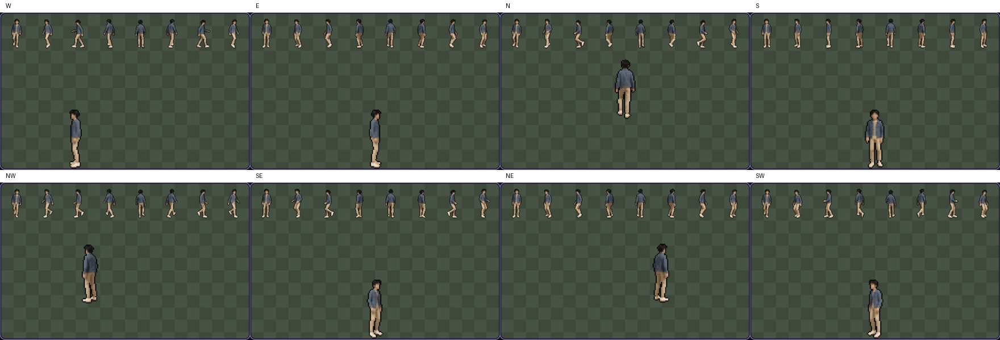
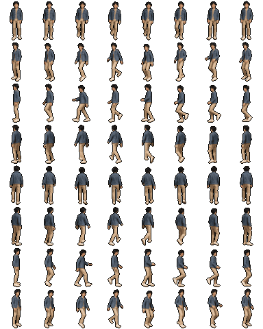

# Sprite Forge on a self-hosted A40, 2026-10-30

All five Kenji direction views and both complete sprite sheets rendered through Railway and
the Runpod Comfy API. Recipes, output contracts, direction controls and GPU execution passed.
**The loop-quality comparison failed:** Best of 3 improved the back loop but had worse seam
ratios than Quick in the other four base directions. This run does not establish uniformly
smooth loops or a guarantee that a new Best of 3 sheet beats a previous Quick sheet.

The temporary pod, its disks and Railway `selfhost` were deleted after collecting the outputs.
Staging retained its original deployment and volume. Estimated total spend was about **$0.85**,
including about **$0.78 for the pod and disks**, within the approved $5 budget. Billing had not
finished posting when the evidence was saved.

## Deployment

| Item | Recorded value |
| --- | --- |
| Source and Railway app commit | `be383ec0aed94d0d9d057ee15e63cd1bbdb1bf32` |
| GPU image tag | `ghcr.io/wojciechjelen/open-photon-comfy:sprite-forge-be383ec` |
| GPU image digest used by the pod | `sha256:7f704152b17bbc5e7ffaa193589ccbd5222d7756dece70c366ec33f2e3e99afc` |
| Build | [GitHub Actions run 41049761990](https://github.com/WojciechJelen/open-photon/actions/runs/41049761990), `selfhost/Dockerfile`, linux/amd64, revision label set to the source commit |
| Anonymous registry access | `docker logout ghcr.io` followed by successful `docker manifest inspect` of the tag |
| Pod | `clzw9tc7n58z04`, Secure Cloud, `EU-SE-1`, NVIDIA A40, $0.59/hour compute |
| GPU as reported by `nvidia-smi` | 46,068 MiB, driver `595.91.07`, CUDA `13.2` |
| Storage | 50 GB container disk; 170 GB persistent disk mounted at `/workspace` |
| Pod proxy during the run | `https://clzw9tc7n58z04-8189.proxy.runpod.net`, port 8189, bearer authentication |
| Railway project / service | `open-photon` / `open-photon` |
| Temporary app | `https://open-photon-selfhost.up.railway.app`, environment `selfhost` |
| Render deployment | `14eea325-3366-4c6e-8542-a499538272ba`, `SUCCESS`, source commit above |
| Queue | `IN_FLIGHT_MAX=1` |
| Database | `/app/data/app.sqlite`, separate volume instance `a2bd6e08-ce41-4050-9c1d-b4af7e914afd` |

The image was published by a separate one-off build that checked out the source commit and
pushed only the new Sprite Forge tag. The existing versioned publish job was not used, and
the released `:0.3.0` tag was not overwritten. The pod used the digest rather than the mutable
tag. See [setup.json](setup.json) and [image-manifest.json](image-manifest.json).

Railway `selfhost` was duplicated from staging. Its Cloud key was removed, its proxy token
matched the pod's new random token, and it received its own database volume instance at
`/app/data`. The queue stayed closed during model installation, then opened at capacity one.
The runtime logged `event="comfy.target"`, `target="selfhost"`, the pod URL and bearer auth.
The successful render deployment answered HTTP 200 with `ok` at `/healthz`. A quota-30 QA
code admitted the seven generations and had 23 uses left afterward. Credentials are omitted.
See [railway-runtime.log](railway-runtime.log) and
[railway-deployment.json](railway-deployment.json).

## Boot and checks

The pod was created at **11:47:36.220 UTC**. It served the API at **12:24:41.760 UTC**, about
37 minutes 6 seconds later, including image pull and the first installation of the repository's
136.1 GB model set. This measures a cold boot, not a restart with a populated model volume.

[boot-and-render.log](boot-and-render.log) preserves all 21 distinct `Verified` lines, the
`sprite_forge` import, both required preflights and the API-ready line:

```text
spriteForge/sprite-sheet.v1: 7 model files, 7 locked, 0 missing (Apache-2.0, MIT)
spriteForge/sprite-view.v1: 5 model files, 5 locked, 0 missing (Apache-2.0)
Serving the Comfy API v2 on 0.0.0.0:8189 (auth: bearer)
```

The external [check:comfy probe](check-comfy.txt) passed with the Cloud key cleared.
`npm run check`, all 325 server tests and the model check passed. All **21 node-pack unit
tests passed on the actual A40**, including the CUDA palette comparison, with no skips.
See [node-tests.txt](node-tests.txt), [gpu-info.txt](gpu-info.txt) and
[validation.json](validation.json). These are real provider renders, not fake-provider tests.

The collected container log contained no CUDA out-of-memory error, CUDA error or Python
traceback through the final render. [log-audit.json](log-audit.json) records the scan; the
boot/render excerpt also includes all seven successful prompt executions.

## Generation timings and memory

Times below are UTC. Duration is the API's `submitted_at` to `finished_at`, so queued time
before submission is excluded. The first view includes loading Qwen; the first sheet includes
loading Wan. Best of 3 ran afterward with warm model caches. These are single observations.

| Generation | Submitted | Finished | Seconds | Peak MiB |
| --- | --- | --- | ---: | ---: |
| Front, S | 12:27:45.565 | 12:30:53.890 | 188.325 | 45,089 |
| Front three-quarter, SW | 12:30:54.491 | 12:31:11.819 | 17.328 | 45,249 |
| Side, W | 12:31:12.384 | 12:31:29.863 | 17.479 | 45,057 |
| Back three-quarter, NW | 12:31:31.374 | 12:31:46.529 | 15.155 | 45,185 |
| Back, N | 12:31:47.676 | 12:32:02.801 | 15.125 | 45,121 |
| Sheet, Quick | 12:33:03.442 | 12:39:59.747 | 416.305 | 43,169 |
| Sheet, Best of 3 | 12:43:48.448 | 12:57:34.240 | 825.792 | 39,241 |

The five views took **257.236 seconds** from the first submission to the last completion,
including the small gaps between jobs. They shared seed `33168478506243`. Quick used seed
`120879560239192`; Best of 3 used `102377815663440`.

[gpu.csv](gpu.csv) contains 3,802 one-second `nvidia-smi` samples in UTC, beginning at
11:54:53.345, before any submission, and ending at 12:58:20.811, after the last completion.
Each peak is the maximum sample satisfying `submitted_at <= timestamp <= finished_at` for
that generation. This is whole-device allocated memory, including cached models, rather than
an isolated model allocation. Sampling can miss peaks shorter than a second. The largest
observed value, 45,249 MiB, leaves only 819 MiB against the GPU's reported capacity.
[verify.json](verify.json) records all IDs, intervals, seeds, peaks and output hashes.

## Recipes and output contracts

All seven API generations were `done`. Every recipe had `target: "selfhost"`, exactly the
workflow hash at the deployed commit, and the workflow's model pins from the sibling
`models.lock`, five files for a view and seven for a sheet:

| Workflow | SHA-256 |
| --- | --- |
| `sprite-view.v1.json` | `40a24063bfc776b040c45d74450b8bfc66309ef50e1b6d826e2d22dfe8b0b654` |
| `sprite-sheet.v1.json` | `dc84a442d6c1a2696a7850fde34595b92d0e09e449ac9f589844d7262be456ba` |

The files `view-*.recipe.json` and `sheet-*.recipe.json` are the seven API recipes.
Their matching `*.generation.json` files retain the API statuses and output descriptors.
[sprite-set.json](sprite-set.json) records `sheets_available: true`, all five completed views
and both completed sheets. Downloaded PNG SHA-256 values matched their asset descriptors.

Both sheets passed the same contract checks:

| Output | Checked result |
| --- | --- |
| `hd` | RGBA PNG, 1024×1280, eight 128×160 frames per row |
| `pixel` | RGBA PNG, 384×480, eight 48×60 frames per row, binary alpha |
| `hd-json` / `pixel-json` | Parseable Aseprite JSON, 64 frames, eight frameTags and eight `meta.loops` entries |
| Tag order | `walk_s`, `walk_sw`, `walk_w`, `walk_nw`, `walk_n`, `walk_ne`, `walk_e`, `walk_se` |
| Pixel palette metadata | 24 entries in `meta.palette` |

The pixel PNGs contain **25 opaque RGB colours**. The node intentionally adds an outline at
half the darkest palette colour's brightness, in addition to the 24 base colours. The metadata
criterion passes; it does not imply a strict 24-colour total PNG. See
[`apply_palette`](../../src/features/spriteForge/comfy_nodes/sprite_forge/sprite_math.py#L349)
and the independent PNG measurements in [atlas-metrics-quick.json](atlas-metrics-quick.json)
and [atlas-metrics-best-of-3.json](atlas-metrics-best-of-3.json).

## Browser and loop-quality results

The browser selected Kenji, drew five directions, then forged Quick followed by Best of 3.
The three turned views clearly faced left, so all default facing controls stayed left.
The completed-view page enabled Forge. Both sheet cards displayed the playground and their
four downloads without an atlas-description error.

The Best of 3 pixel playground passed all eight WASD directions, held for 800 ms each. A moved
left while facing left, D moved right while facing right, W showed the back, and S showed the
front. The diagonal chords selected the corresponding three-quarter views. Quick's HD
playground also responded correctly to Up and Down. The animated direction strip advanced
frames. Inspection of every back-row frame in both atlases found no turn toward the camera.
See [browser-checks.json](browser-checks.json), [views-done.png](views-done.png),
[control-quick-n.png](control-quick-n.png) and the eight recorded control states below.



The loop-quality criterion is **not a pass**. These are the sheets' recorded seam ratios,
where lower is better. East-facing rows mirror their west-facing counterparts.

| Row | Quick | Best of 3 | Kept take | Comparison |
| --- | ---: | ---: | ---: | --- |
| S | 0.724 | 1.349 | 2 | Worse |
| SW / SE | 1.029 | 1.059 | 3 | Worse |
| W / E | 0.531 | 0.788 | 1 | Worse |
| NW / NE | 1.150 | 1.559 | 3 | Worse |
| N | 2.097 | 0.760 | 3 | Better |

Best of 3 selects among its own three takes. A separate Quick sheet has a different random
seed, so the comparison does not test whether the selector rejected its own best candidate.
It does show that the requested expectation, that the second sheet's scores should never
be worse, did not hold. No rerolls were used to hide the result. Quick's back row has the
weakest recorded seam and limited walking motion; a blanket claim of jump-free loops is
unsupported. The packed-frame audit also finds Quick's back wrap larger than its largest
internal step, while Best of 3's wraps are below their largest internal steps. That audit uses
premultiplied RGBA differences after packing, a different metric from `meta.loops`' selection
score, and does not overturn the failed comparison.

The original outputs are retained for inspection:

| Mode | HD PNG | Pixel PNG | HD JSON | Pixel JSON |
| --- | --- | --- | --- | --- |
| Quick | [PNG](sheet-quick-hd.png) | [PNG](sheet-quick-pixel.png) | [JSON](sheet-quick-hd-json.json) | [JSON](sheet-quick-pixel-json.json) |
| Best of 3 | [PNG](sheet-best-of-3-hd.png) | [PNG](sheet-best-of-3-pixel.png) | [JSON](sheet-best-of-3-hd-json.json) | [JSON](sheet-best-of-3-pixel-json.json) |



## Cost and teardown

The Runpod stop completed by **13:02:47 UTC**, about 75 minutes 11 seconds after creation.
At $0.59/hour, estimated GPU compute was $0.739. Running storage for 220 GB at
$0.10/GB/month adds about $0.038 using 720 hours/month. The combined pod estimate is **$0.778**.
Its early billing snapshot showed only $0.1723 and was incomplete; it is preserved in
[cost.json](cost.json), not presented as the final bill. Rates follow
[Runpod's Pod pricing](https://docs.runpod.io/pods/pricing).

Railway existed for about 89 minutes, with a one-CPU, one-GB RAM ceiling and a five-GB volume
capacity. Even charging the configured ceilings for that entire interval gives about $0.07
for compute and storage. Output-download egress adds a fraction of a cent. Actual usage should
be lower; no final Railway invoice was available. See
[Railway pricing](https://docs.railway.com/pricing/plans). Standard public
[GitHub Actions runners](https://docs.github.com/en/billing/concepts/product-billing/github-actions)
and [GHCR container storage/bandwidth](https://docs.github.com/en/billing/concepts/product-billing/github-packages)
add no expected charge for this build and public image.

After saving the outputs and stopping the GPU recorder:

- The pod was stopped, then deleted. A read-back returned HTTP 404.
- Railway environment `selfhost` was deleted, removing its temporary deployment and volume instance.
- Staging deployment `d45fad65-ece5-4265-9bd0-5cb05d08c667` remained `SUCCESS` and its volume
  instance `4e58dba0-d454-439a-b03c-4d8616703018` remained `READY` at `/app/data`.
- The local Railway link returned to staging; the local budget guard and log recorder stopped.

[cleanup.json](cleanup.json) records the provider read-backs. The temporary app and pod URLs
are historical references and no longer serve these outputs. The public GPU image remains
available for a future deployment.
