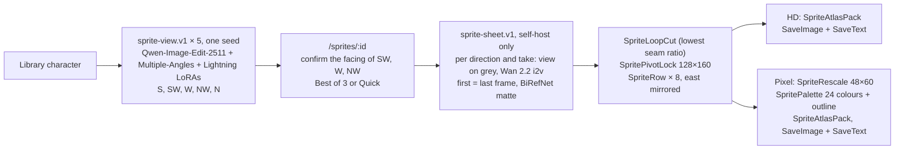

# Sprite Forge

Sprite Forge (`/sprites`) turns a library character into an 8-direction walk-cycle sprite sheet a
game engine loads directly: an RGBA PNG atlas plus its Aseprite JSON (frames, one tag per
direction, pivots). It draws an HD sheet (128×160 cells) and a pixel-art sheet (48×60 cells, 24
colours, outlined). The views render on either backend; the sheet renders only on a self-hosted
ComfyUI, because it runs this folder's custom ComfyUI nodes ([Self-host](#self-host)).

## How it works

1. `/sprites`: pick a library character and choose **Draw 5 directions**. That admits five
   `sprite-view` generations, one per direction (S, SW, W, NW, N) with one seed: Shots & Angles'
   Qwen-Image-Edit-2511 graph with the fal Multiple-Angles LoRA and the lightx2v Lightning LoRA.
2. `/sprites/:id`: confirm which way each turned view (SW, W, NW) faces (**Faces left** or
   **Faces right**, left preselected) and choose the takes: **Best of 3** (the default) or
   **Quick** (one).
3. **Forge sprite sheet** admits one `sprite-sheet` generation. Per direction, Wan 2.2 14B
   image-to-video (fp8, with the lightx2v 4-step LoRAs) walks the view on flat grey with the view
   as both first and last frame, once per take, and BiRefNet mattes the frames. The Sprite Forge
   nodes keep the take with the lowest seam ratio, lock it to a fixed cell, mirror the west side
   into the east one and pack both atlases; core `SaveImage` (RGBA PNG) and `SaveText` (compact
   Aseprite JSON array, with Sprite Forge's own `meta.loops`) save them as the outputs `hd`,
   `hd-json`, `pixel` and `pixel-json`.
4. The page shows a WASD playground (HD/Pixel switch), the loop quality of each direction (kept
   take and seam ratio) and four downloads: `<slug>-walk-hd.png`, `<slug>-walk-hd.json`,
   `<slug>-walk-pixel.png` and `<slug>-walk-pixel.json`. Each JSON's `meta.image` names its PNG.



Node by node, the two graphs, their inputs, node ids and models are in
[`workflows/README.md`](workflows/README.md). Best of 3 renders 15 walk clips per sheet, Quick 5.

Files: contracts `contracts.ts`; client `sprite-client.ts`, `components/sprite-forge-page.tsx`,
`components/sprite-set-page.tsx`, `components/sprite-playground.tsx`; server
`server/repository.ts`, `server/sprite-sets.ts`, `server/http.ts`; workflows `workflows/`
(definitions, builder, graphs, inputs maps, `models.lock`); node pack `comfy_nodes/sprite_forge/`
and its tests `comfy_nodes/tests/`; tests `tests/`; the migration
`src/shared/server/migrations/spriteForge/001-sprite-sets.sql`; the routes
`src/routes/sprites.index.tsx`, `src/routes/sprites.$spriteSetId.tsx` and
`src/routes/api.sprite-sets*.ts`.

## Self-host

A sheet runs the Sprite Forge custom nodes, and Comfy Cloud does not let users install custom
nodes ("Can I install or import my custom nodes on Comfy Cloud? Not at the moment",
[Custom nodes on Cloud](https://support.comfy.org/articles/6791455062-custom-nodes-on-cloud)).
To forge sheets, run the self-hosted ComfyUI image built from `selfhost/Dockerfile` at or after
the change that shipped Sprite Forge, and point the app at it with `COMFY_BASE_URL` and
`COMFY_PROXY_TOKEN` (the root [README](../../../README.md#choose-a-rendering-backend)).

- **How the pack gets there.** `selfhost/Dockerfile` copies
  `src/features/spriteForge/comfy_nodes/sprite_forge` to
  `/opt/ComfyUI/custom_nodes/sprite_forge`. The pack needs only torch, numpy and Pillow, which
  ComfyUI's requirements already install.
- **Preflight.** Before serving, the entrypoint runs
  `node scripts/check-models-lock.mjs --definitions` against ComfyUI's `/object_info`; it fails
  boot when ComfyUI lacks a node class a runtime workflow uses, so an image built with the
  Sprite Forge workflows but without the pack does not start.
- **Older images.** An image built before this change lacks the nodes: rebuild it.
- **Models.** Nothing new to download: `models.lock` reuses the files `angles` (Qwen),
  `animateImage` (Wan 2.2 i2v) and `productStudio` (BiRefNet) already pin.

On Comfy Cloud the views still work: draw the five directions and confirm their facing. The
**Forge sprite sheet** button is disabled with an explanation, and
`POST /api/sprite-sets/:id/sheets` answers 422 `selfhost_required` and stores nothing. The server
decides from its Comfy target (`sheets_available` is true only for a self-hosted one).

## The node pack (`comfy_nodes/sprite_forge`)

V3 nodes (`comfy_api.latest`, category `sprite forge`); MASK inputs follow `RemoveBackground`
(1 = character). The math (`sprite_math.py`, `atlas.py`) imports without ComfyUI; `__init__.py`
loads the nodes only when ComfyUI asks.

| Node | Does |
| --- | --- |
| `SpriteFramesLoad` | Every PNG of a folder under ComfyUI's input directory, as frames and alpha; refuses a PNG (e.g. a symlink) that does not resolve to a regular file inside the input directory. Only the prototype's sheet graph uses it, to bring Cloud's walk frames into a local ComfyUI; the runtime graph does not. |
| `SpriteLoopCut` | The stretch that loops best: seam over motion, where the seam compares the frames on both sides of the cut (so a walk's half cycle, legs crossing the other way, loses to a full one), and the shortest loop within 10% of the best wins (one cycle, not two). Only stretches that move count: their mean step must reach a quarter of the clip's pace (the 90th percentile of its frame-to-frame differences), so the standing frames a clip starts and ends with are never the loop. Given up to three takes (`frames`/`mask`, optional `frames_2`/`mask_2`, `frames_3`/`mask_3`), keeps the take with the lowest seam ratio, measuring motion against the fastest take's pace, so a take that stands still loses; fails when no take moves (run it again with other seeds). Samples `frame_count` evenly spaced frames; outputs `loop_start`, `loop_length`, `seam_ratio` and the kept `take`. |
| `SpritePivotLock` | Every frame on a fixed cell at one scale: lowest character row on the ground line, head-and-chest centroid on the centre column. Removes the drift and jitter of a generated clip, keeps stride and bob. |
| `SpriteRow` | Adds one direction to a sheet, mirrored with `flip_horizontal` (pivot mirrored too). Chained, one per direction. Given `SpriteLoopCut`'s `seam_ratio` and `take` (both or neither), the atlas JSON reports them for the row. |
| `SpriteRescale` | Every row to a new cell size, pivots moved with the cells. |
| `SpritePalette` | One k-means palette for every frame of every row, hard 0/1 alpha, optional one-pixel outline at half the darkest palette colour's brightness. The outline can add one colour beyond the declared base palette. Deterministic: fitted on the CPU whatever device the frames are on. |
| `SpriteAtlasPack` | The atlas as an RGBA IMAGE (one row per direction) and its compact Aseprite JSON array as a STRING (`frames`, `frameTags`, a `pivot` slice keyed per tag, `palette` when there is one, `loops` when rows carry a take and seam ratio; `meta.image` from `image_name`). Saves nothing: core `SaveImage` and `SaveText` do. |

## Verification of the shipped code (2026-10-30)

- **Comfy Cloud, through the built app.** Kenji's five views rendered in 34 s
  (`IN_FLIGHT_MAX=2`), with recipe `sprite-view.v1`, target `cloud` and the five prompts of
  `workflows/view-definition.ts`. All three turned views faced screen-left again. The forge
  button was disabled and the sheet POST answered 422 `selfhost_required`, storing nothing.
- **Local ComfyUI 0.42.0 (the self-host pin) with the node pack, on CPU.** Every node of
  `sprite-view.v1.json` (17 nodes) and `sprite-sheet.v1.json` (134 nodes; 84 after pruning to one
  take) exists in `/object_info`, with all required inputs and type-matching links. The sheet
  graph's custom-node half, fed the prototype's real Cloud walk frames in place of the Wan
  branches, ran in 3.0 s. It kept NW take 3 (seam ratio 1.269 against 2.578 and 1.698) and N
  take 2 (0.890 against 2.532 and 1.190), the takes the prototype chose by hand, and saved a
  1024×1280 RGBA HD atlas and a 384×480 pixel atlas with JSON of 14,093 and 13,906 bytes (the
  app's text-output limit is 16,384).
- **Gates.** `npm run check`; `npm run test:server` (325 tests, 9 of them Sprite Forge's); the 21
  node-pack unit tests; `npm run check:models` (`spriteForge/sprite-view.v1: 5 model files`,
  `spriteForge/sprite-sheet.v1: 7 model files`, 0 conflicts); `npm run check:open-weights`
  (0 forbidden); Playwright `tests/sprites.fake.spec.ts` (this folder) and the root
  `tests/app.spec.ts`.

**Self-hosted A40, 2026-10-30.** The rebuilt image rendered Kenji's five views, then complete
Quick and Best of 3 sheets through Railway. The views took 257.2 s together and peaked at
45,249 MiB; Quick took 416.3 s at 43,169 MiB; Best of 3 took 825.8 s at 39,241 MiB. All seven
recipes matched the deployed workflows and model pins, both atlas contracts passed, all eight
playground directions worked, and every back-row frame stayed back-facing. All 21 node-pack
unit tests passed on the GPU without skips. Best of 3 improved the back seam from 2.097 to
0.760 but worsened the other four base directions against the independently seeded Quick
sheet, so the quality comparison failed. The 24-entry pixel palette gains a separate outline
colour in the PNG. The [evidence](../../../docs/selfhost-proof-2026-10-30-sprite-forge/README.md)
includes the cold/warm timings, samples, original outputs and cleanup. Estimated pod and disk
cost was $0.78; the temporary pod and Railway environment were deleted. Actions other than
walk were not tried.

The models are Apache-2.0 (Qwen-Image-Edit-2511, the Multiple-Angles and Lightning LoRAs, Wan 2.2
and its lightx2v LoRAs) and MIT
(BiRefNet), as pinned in `workflows/models.lock`.

## Running it

```bash
# Tests of the node math (torch, numpy and Pillow: ComfyUI's own dependencies).
python -m unittest discover -s src/features/spriteForge/comfy_nodes/tests

# Server tests of the definitions and sets (also part of npm run test:server).
node --experimental-strip-types --test 'src/features/spriteForge/tests/*.test.ts'

# Runtime workflows (regenerate, then format as the repository does).
python3 src/features/spriteForge/workflows/build_workflows.py
npx oxfmt src/features/spriteForge/workflows

# Prototype graphs.
python3 src/features/spriteForge/prototype/build_graphs.py
npx oxfmt src/features/spriteForge/prototype/graphs

# Prototype, Cloud half (COMFY_API_KEY in .env): views, then one walk per direction (view as node 1's image).
R=src/features/spriteForge/prototype/run_cloud.mjs G=src/features/spriteForge/prototype/graphs
node --env-file=.env $R $G/directions.api.json out/directions 1:image=<character.png>
node --env-file=.env $R $G/walk.api.json out/walk-w 1:image=out/directions/3002/<view>.png 13:noise_seed=20261031

# Prototype, local half: ComfyUI at the self-host pin with the node pack linked in.
git clone https://github.com/Comfy-Org/ComfyUI && git -C ComfyUI checkout 7a28332047b6af638dc6c7f72ef3481a718769fd
ln -s "$PWD/src/features/spriteForge/comfy_nodes/sprite_forge" ComfyUI/custom_nodes/sprite_forge
python ComfyUI/main.py --cpu --port 8288   # in a venv with ComfyUI's requirements
# copy each walk's RGBA frames (node 34) to ComfyUI/input/sprite-forge/kenji/walk-<s|sw|w|nw|n>/
python3 src/features/spriteForge/prototype/run_local.py src/features/spriteForge/prototype/graphs/sheet.api.json

# Prototype playground: serve the repository, open the page with an atlas JSON.
python3 -m http.server 8299   # then http://127.0.0.1:8299/src/features/spriteForge/prototype/playground.html?json=results/kenji/pixel_00003_.json
```

## Prototype

Before the feature shipped, `prototype/` validated each choice above on Kenji (2026-10-29/30) in
two halves: the GPU half on Comfy Cloud with core nodes only (`directions.api.json`,
`walk.api.json` per direction), the node pack in a local ComfyUI 0.42.0 on CPU
(`sheet.api.json`, loading Cloud's frames with `SpriteFramesLoad`). Its `SpriteAtlasSave` node is
now `SpriteAtlasPack`, which saves no file (core `SaveImage` and `SaveText` do), and
`SpriteLoopCut` gained takes 2 and 3; `build_graphs.py` writes the new nodes. The results in
`prototype/results/kenji/` were made by the old node, which also wrote an animated WebP preview,
and stay as the prototype's record.

**Directions.** One Cloud job (`32f98c8d`, 30 s execution) drew five views. Every turned view of
Kenji faces screen-left (`verification/directions.jpg`), so the sheet mirrors south-west, west and
north-west into south-east, east and north-east. Which side the LoRA turns to is its choice per
image (`docs/feature-evidence/shots-and-angles/`), hence the shipped page asks the user to confirm
each turned view's facing.

**Closed loops.** With the view as both first and last frame, Wan walks in place and comes back
to the start pose. Without the last frame (`walk-w-open`, `f8430bd4`) the character turned to the
camera and the striped shirt became brown (`verification/walk-clips.jpg`, bottom row).

**Back view.** The general walk prompt turned the north clip to the camera mid-clip (`6c1f8e94`);
the back-view prompt (`WALK_PROMPT_BACK`) kept it facing away in all three seeds rendered.

**Best of three.** Clips differ in how periodic Wan's stepping is; the seam ratio ranks them. Each
clip ran 42–50 s on Cloud (`verification/*.job.json`). Kept: bold.

| Direction | Cloud job | Loop (frames) | Seam ratio |
| --- | --- | --- | --- |
| S | `d26844f2` | **15..34 (20)** | **0.49** |
| SW | `bbb35d87` | **17..38 (22)** | **1.34** |
| W | `da856a00` | **20..35 (16)** | **1.54** |
| NW, seed 20261029 | `57c94acc` | 10..26 (17) | 2.58 |
| NW, seed 20261030 | `ceddf507` | 11..20 (10) | 1.70 |
| NW, seed 20261031 | `d23431cb` | **21..36 (16)** | **1.27** |
| N, general prompt | `6c1f8e94` | turned to camera | 2.34 |
| N, back prompt, seed 20261029 | `02b58927` | 20..29 (10) | 2.53 |
| N, back prompt, seed 20261030 | `c3eec8b2` | **11..32 (22)** | **0.89** |
| N, back prompt, seed 20261031 | `a0045e97` | 8..25 (18) | 1.19 |

Seam ratio: mean difference across the cut over mean difference between consecutive frames, on
the 49 frames at 16 fps (`verification/loop-scores.json`). Sampled to 8 frames, the kept loops wrap
with a step 0.95–1.46× the median step and at most 1.05× the largest step inside the loop, for
both atlases: the seam is no larger than a normal step.

**Local graph.** The pack's seven nodes registered in ComfyUI 0.42.0 (`/object_info`, category
`sprite forge`), rendered in its editor, and `sheet.api.json` ran from the editor's Run button and
from `run_local.py`: 3.6 s on CPU for both atlases, 1.0 s after one input folder changed (the
loader's fingerprint re-runs only that branch).

**Results** (`prototype/results/kenji/`): `hd_00003_.png` 1024×1280 (8 directions × 8 frames of
128×160), `pixel_00003_.png` 384×480 (48×60 cells, 24 colours, outlined), each with its JSON and
WebP preview. `prototype/playground.html` walks the character with WASD using only the PNG and its
JSON: each of the eight key combinations picks its `walk_<direction>` tag and moves that way.

The results derive from the sample character `kenji.png`, a FLUX 3 Klein render under the FLUX
Kommunity License v1.0 (`src/features/characters/samples/characters/manifest.json`).
